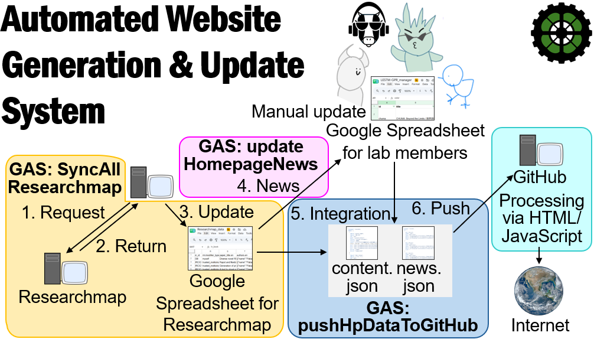

  

# Automated Website Generation & Update System

This is an integrated system designed to fully automate the content updates and deployment of the lab website (HTML/JavaScript) by leveraging Google Sheets and the Researchmap API.

## 📊 System Architecture Diagram
The system automatically coordinates data flows as illustrated in the architecture diagram below:

1. **Researchmap Synchronization**: `GAS: syncAllResearchmap` fetches the latest publication and award records via the Researchmap API. **[1. Request -> 2. Return]**
2. **Spreadsheet Ingestion**: The retrieved data is populated into the "Google Spreadsheet for Researchmap". **[3. Update]**
3. **Automated News/Event Extraction**: `GAS: updateHomepageNews` detects new papers or updates in lab members (e.g., graduations, Ph.D. awards) and automatically integrates them into the "News" sheet. **[4. News]**
4. **GitHub Deployment**: `GAS: pushHpDataToGitHub` merges all data streams and commits them directly to this repository as `content.json` and `news.json`. **[5. Integration -> 6. Push]**
5. **Client-side Rendering**: The HTML/JavaScript on the website reads these JSON files and dynamically renders a modern, tech-inspired responsive UI for users.

---

## 🛠️ Latest Update: Links Section Expansion & Optimization

To present databases and web tools in a more visually intuitive and engaging manner, we have **expanded the Links section data structure and overhauled the UI using a lightweight style-override approach**.

### 1. Data Structure Expansion (3-Category System)
The categories managed in the Google Sheet (`Links`) have been categorized into **three distinct sections**:
*   **`Tools & Platforms`** (formerly Web Tools & Databases): Databases, software, and platforms developed by the lab. *(Rendered as visual grid cards)*
*   **`Affiliations`**: Linked organizations, academic societies, and research centers. *(Rendered as clean text lists)*
*   **`External Resources`** `[★ Newly Added]`: Other relevant external tools or references. *(Rendered as clean text lists)*

### 2. Automatic Direct Link Conversion for Square Logos
*   By adding a logo image filename (e.g., `Turnip.avif`) in the 5th column (Column E) of the `Links` sheet, the GAS `fileLinkMap` automatically looks up the file in the designated Google Drive folder.
*   The system extracts the unique File ID and converts it into a web-accessible direct link URL (`https://googleusercontent.com{ID}`), passing it smoothly into the `pic` property within the final JSON payload.

### 3. Client UI Revamp (Reusing Existing CSS via Pinpoint Style Overrides)
To keep the codebase minimal, we reused the existing `.project-grid` and `.project-card` classes instead of introducing heavy new CSS classes.

*   **Square (1:1) Icon Frame**: Applied pinpoint inline styling (`aspect-ratio: 1/1; width: 110px;`) to automatically fit any square logo into a centralized, modern app-dashboard layout.
*   **Seamless Interaction**: The cards naturally inherit the existing `.clickable:hover` transition. When hovered, the card floats upwards by 5px with a deeper drop-shadow, preserving the lab's cohesive biotech-dashboard aesthetic.

---

## 📁 Key File Structure

*   `style2.css` / Inline CSS: Defines the overall tech aesthetic (monospace fonts, clean geometric borders) and houses the core responsive grid frameworks (`.project-grid` / `.project-card`).
*   `index.html` (JavaScript Section): Handles client-side rendering inside `loadLabData()` to dynamically split incoming links into three distinct containers (`#links-tools-container`, `#links-affiliations-container`, `#links-external-container`).
*   `GAS Codes (Google Apps Script)`:
    *   `syncAllResearchmap()`: Automatically syncs data from Researchmap.
    *   `updateHomepageNews()`: Tracks sheet changes and automatically formats and feeds new logs into the News stream.
    *   `pushHpDataToGitHub()`: Cleans data streams, resolves the newly added 5th column image references, and pushes the final JSON outputs to GitHub.

---

## 🚀 Operation & Maintenance Workflow

1.  **Adding a New Tool or Resource**:
    *   Open the `Links` sheet in your main lab Google Spreadsheet.
    *   Set the `category` column to `Tools & Platforms`, `Affiliations`, or `External Resources`.
    *   If selecting `Tools & Platforms`, enter the exact filename (including the extension) of the square logo sitting in the designated Google Drive folder into Column E.
2.  **Automated Deployment**:
    *   The scheduled GAS triggers will run automatically, update the JSON files on GitHub, and reflect the new assets instantly on the live website.

---

# Automated Website Generation & Update System

Google スプレッドシートおよび Researchmap API を活用し、研究室ウェブサイト（HTML/JavaScript）のコンテンツを自動で更新・配信するシステムです。

## 📊 システム概要図
本システムは以下のフロー（構成図通り）で自動連携を行っています。

1. **Researchmap 同期**: `GAS: syncAllResearchmap` が API を叩き最新の業績データを取得 [1. Request -> 2. Return]
2. **ローカルスプレッドシート反映**: 取得したデータを「Google Spreadsheet for Researchmap」に格納 [3. Update]
3. **お知らせ・イベント自動抽出**: `GAS: updateHomepageNews` が、新着論文やメンバーの卒業・学位取得情報を検知し、自動的に「News」シートへ統合 [4. News]
4. **GitHub 配信**: `GAS: pushHpDataToGitHub` がすべてのデータを統合し、`content.json` および `news.json` としてリポジトリへ直接コミット [5. Integration -> 6. Push]
5. **クライアント描画**: 配信された JSON データを、ウェブサイト側の HTML/JavaScript がリキッド・レスポンシブなテック調 UI へと動的にレンダリングします。

---

## 🛠️ 今回のアップデート：Links セクションの仕様変更

データベースやウェブツールの紹介をより視覚的かつ直感的に行うため、**Links セクションの拡張および UI 刷新（省コード流用デザイン）**を行いました。

### 1. データ構造の拡張 (3カテゴリ化)
Google スプレッドシート（`Links` シート）側で管理するカテゴリを以下の **3つに分類・整理** しました。
*   **`Tools & Platforms`** (旧 Web Tools & Databases): 研究室が開発・提供するデータベースやツール（※ロゴ画像によるカード表示対象）
*   **`Affiliations`**: 所属組織、関連学会、研究センターなど（テキストリンク形式）
*   **`External Resources`** [★新規追加]: その他の外部関連リソース（テキストリンク形式）

### 2. ロゴ画像（正方形）の自動直リンク変換
*   `Links` シートの 5 列目（E列）にロゴ用の画像ファイル名（例: `Turnip.avif`）を追記することで、GAS 内の `fileLinkMap` が Google ドライブの共有フォルダから該当ファイルを自動検知します。
*   自動取得された固有 ID をベースに、ウェブから直接参照可能な直リンク URL（`https://googleusercontent.com{ID}`）へと自動変換され、JSON の `pic` プロパティへ格納されます。

### 3. クライアント UI の刷新 (既存 CSS の流用＋ピンポイント上書き案)
サイト全体のコード量を最小限に抑えつつ、正方形ロゴを美しく配置するため、既存の `project-grid` / `project-card` クラスをそのまま流用して上書きするアプローチを採用しました。

*   **正方形（1:1）のアイコン枠**: インラインスタイル（`aspect-ratio: 1/1; width: 110px;`）をピンポイント適用し、あらゆる正方形ロゴが中央に綺麗に収まるダッシュボード・アプリストア風のレイアウトを実現。
*   **ホバーエフェクトの継承**: 既存の `.clickable:hover` がそのまま適用されるため、カードが上に 5px 浮き上がり、テック調の無機質な世界観を崩さずに洗練された動的 UI を維持しています。

---

## 📁 主要ファイル構成

*   `style2.css` / インラインCSS: サイト全体のモダンゴシック・等幅フォントベースのデザイン、およびベースとなるグリッドレイアウト（`.project-grid` / `.project-card`）を定義。
*   `index.html` (JavaScript部): `loadLabData()` 内で 3 つのコンテナ（`#links-tools-container`, `#links-affiliations-container`, `#links-external-container`）へ JSON データを条件分岐で動的レンダリング。
*   `GASコード（Google Apps Script）`:
    *   `syncAllResearchmap()`: Researchmap からの自動データ同期。
    *   `updateHomepageNews()`: スプレッドシート内の変更、新規論文の公開を検知して News を生成。
    *   `pushHpDataToGitHub()`: 今回拡張した 5 列目のロゴ画像名を含め、データをクレンジングして GitHub へプッシュ。

---

## 🚀 運用・メンテナンス手順

1.  **新しいツールやプラットフォームを追加する場合**:
    *   研究室メンバー用 Google スプレッドシートの `Links` シートを開きます。
    *   `category` 列に `Tools & Platforms` を指定します。
    *   E列（5列目）に、指定の Google ドライブフォルダ内にある正方形ロゴのファイル名（拡張子含む）を入力します。
2.  **自動反映**:
    *   トリガー設定された GAS が実行されると、GitHub 経由で即座に公開ウェブサイト側がアイコン付きのダッシュボードカード形式で自動更新されます。
